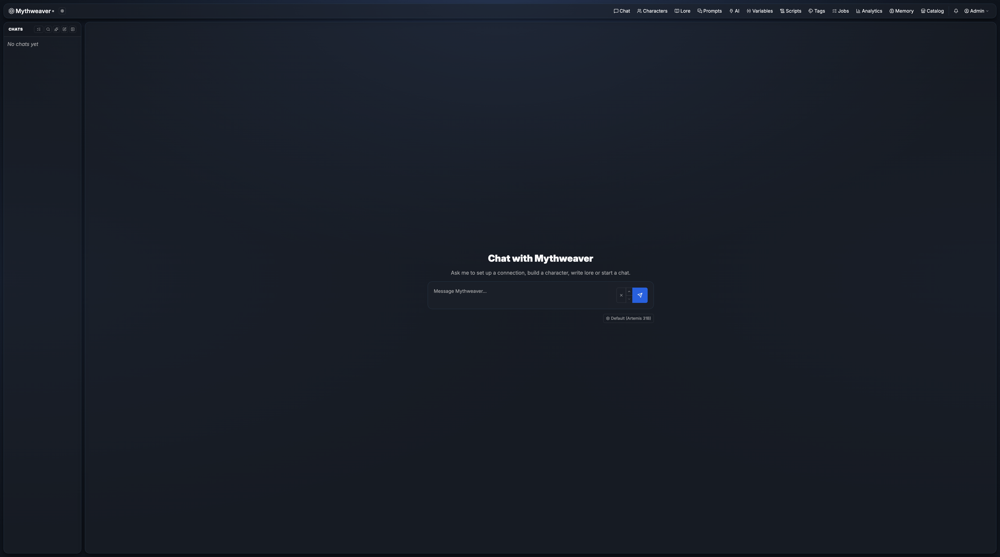
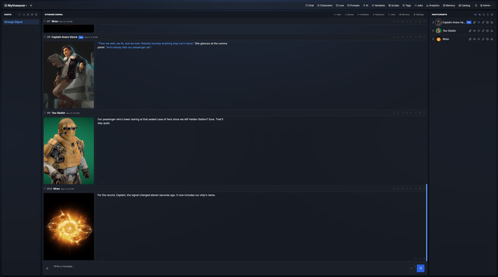
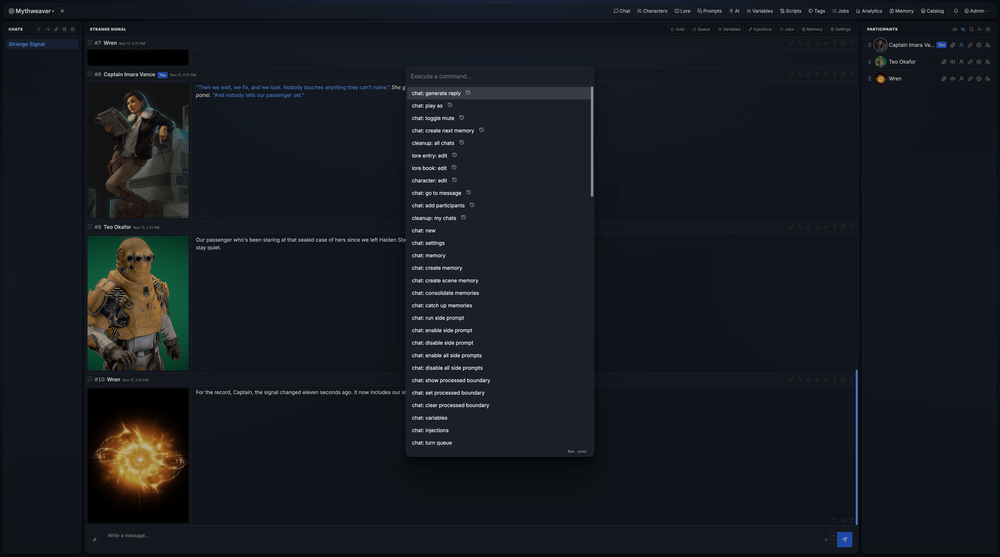
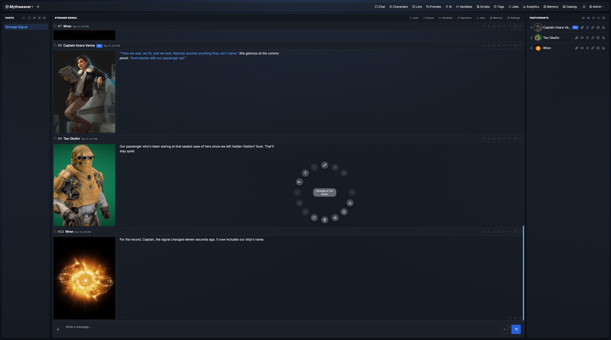
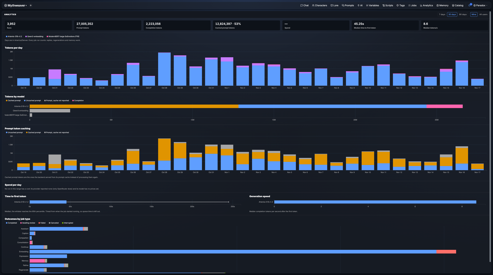
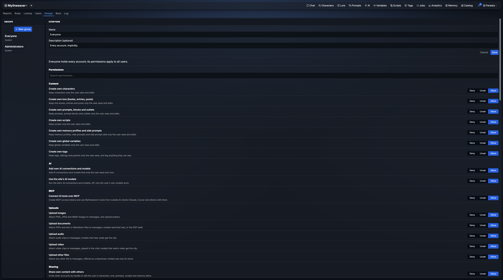

Mythweaver is a self-hosted app for AI role-play with one or many characters in a group chat. You bring the AI models (a hosted API or one you run yourself), write characters and lore, and play out scenes where the characters take turns replying.

You can use it by yourself, for your own RP, or with friends, in real-time group chats (Discord style). Users can be assigned characters, or it can be a big free-for-all. 

## Screenshots

|||
|-|-|
|||
|||

## Where to start

- **New to Mythweaver?** Follow [Getting started](getting-started/index.md): claim the install, connect a model and start your first chat.
- **Setting up a server?** Read [Installation](administration/installation.md) and [Environment variables](administration/configuration.md).
- **Looking for something specific?** Press `/` to search, or browse the sections below.

## Sections

| Section | What it covers |
| --- | --- |
| [Getting started](getting-started/index.md) | The first run, connecting a model and your first chat. |
| [Chats](chats/index.md) | Messages, swipes, the composer, group chats and turn-taking, chat settings and sharing. |
| [Characters](characters/index.md) | The character editor, expressions and sprites. |
| [AI connections and models](ai/index.md) | Connections to AI providers, models and how a provider is picked for each call. |
| [Prompts](prompts/index.md) | Prompts, blocks, outlets, the template language and variables. |
| [Lore](lore/index.md) | Lore books and entries, activation, timing, budgets, pools and vector lore. |
| [Memory](memory/index.md) | Memory Books: profiles, side prompts, consolidation, clips and character books. |
| [Scripts](scripts/index.md) | Lua scripts that react to chat events, and the script API. |
| [Images and attachments](images/index.md) | Attaching files, image descriptions and image settings. |
| [Tools](tools/index.md) | The assistant, the command palette, import and export, tags, jobs and MCP. |
| [Account and settings](account/index.md) | Your account, settings, appearance and notifications. |
| [Administration](administration/index.md) | Installing and configuring the server, users and permissions, and moderation. |
